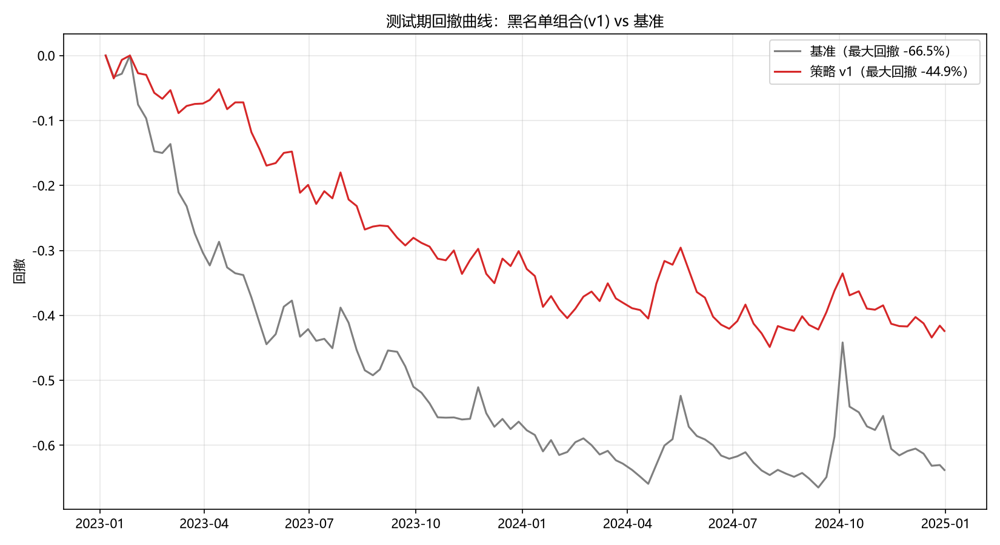
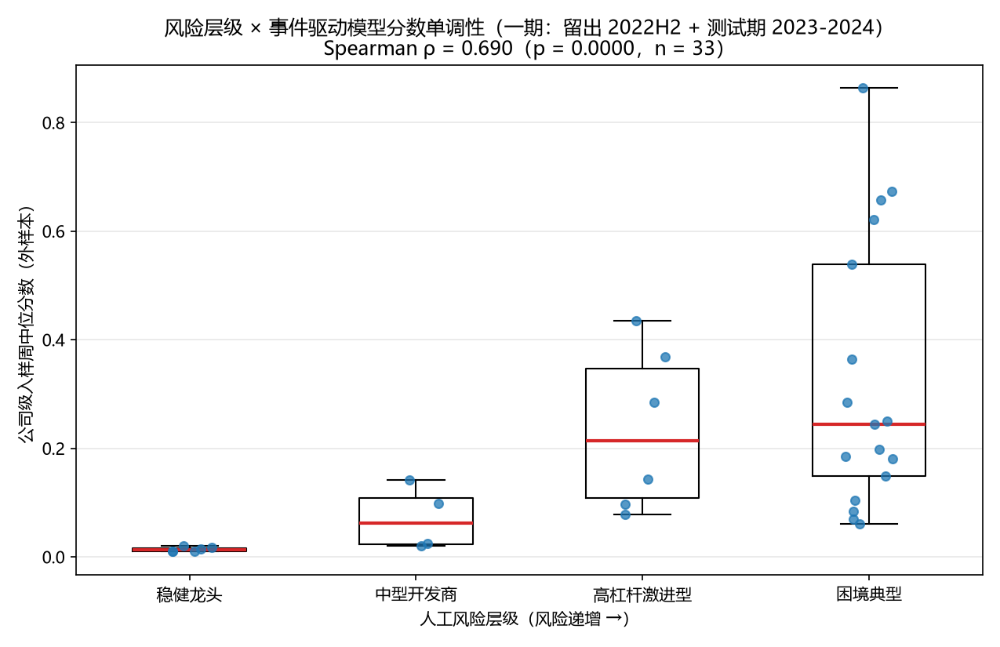

# Credit Risk Early Warning for Hong Kong-Listed Property Developers

An event-driven early-warning system that scores credit distress risk for Hong Kong-listed
property developers on a weekly panel, and tests whether those scores can drive a fund's
exclusion (blacklist) decision.

Independent research project · Python 3.11 · LightGBM · scikit-learn · SHAP · Microsoft SQL Server · Streamlit

---

## Results at a glance

| | Phase 1 (panel 2019–2024) | Phase 2 (panel 2019–2025) |
|---|---|---|
| Issuers in panel | 44 | 44 |
| Manually verified credit events | 86 (34 issuers) | +18 for 2025 (14 issuers) |
| Split: train / holdout / test | 2019-01→2022-05 / 2022-06→2022-12 / **2023–2024** | ≤2023-12-31 / 2024 / **2025** |
| Test-period AUC | **0.8621** | 0.9902 full panel · **0.8615** restricted to event issuers |
| Event-level hit rate at the frozen threshold | — | **15 / 17 (88.2%)** |
| Blacklist backtest — max drawdown | **−66.5% → −44.9% (21.6 pp)** | benchmark −26.35% → v1 −11.02% (15.3 pp) |
| Risk-tier monotonicity (Spearman ρ) | 0.690 (n = 33) | 0.840 (n = 30) |



*Max drawdown, blacklist overlay vs. equal-weight benchmark, held-out period 2023–2024.*

---

## The problem

Fund mandates increasingly exclude distressed developers, but exclusion rules tend to be
backward-looking: they react to price collapses rather than to credit events. The task here is
to score default risk **before** the market reprices it, and to turn that score into a rule a
risk committee can actually operate.

## What makes this project different

**1. The label comes from filings, not from prices.**
Most student credit-risk models define distress as a price decline (e.g. −15% in a window).
That label is circular — it only exists once the market has already reacted. Here the target is
an **event-driven label** built from 86 manually verified credit events across five hard-signal
categories, each anchored to its HKEX disclosure date:

| Category | Count |
|---|---|
| Default announcement | 31 |
| Rating first downgraded to CCC or below | 22 |
| Winding-up petition announcement | 17 |
| Distressed exchange | 9 |
| Debt extension announcement | 7 |
| **Total** | **86** |

Source: [`data/events/events.csv`](data/events/events.csv) — five columns
(`股票代码, 公司简称, 公告日, 事件类型, 来源链接`), so every row carries its own announcement date
and a link to the original filing or rating action. The encoding rules and the clustering logic
are described in [METHODOLOGY.md](METHODOLOGY.md).

**2. Leakage control is structural, not promised.**
The evaluation protocol is built so that leakage is impossible by construction:

- **Three-way time split** with a held-out validation segment used only for calibration and
  threshold selection; the test period is touched exactly once.
- **8-week purge bands** around every cut point, because the label window is 8 weeks wide —
  no observation whose label crosses a boundary enters fitting.
- **Transform statistics** (z-score means/stds, VIF, winsorisation quantiles) are fitted on the
  training segment only; holdout and test are transform-only.
- **Phase 2 re-uses the Phase 1 test period as training data** and holds 2025 back as a fresh,
  pre-registered exam — then reports the result regardless of outcome.

Implementation: [`src/data/split.py`](src/data/split.py), [`src/features/preprocessing.py`](src/features/preprocessing.py).

**3. A placebo control that undercut the headline number.**
The blacklist overlay reduced maximum drawdown from −66.5% to −44.9%. A placebo test — removing
the same *number* of names each week but choosing them at random — reproduced most of that gain.
The honest reading is that the improvement came largely from **reduced exposure rather than
issuer selection**. That finding is reported here rather than omitted, because it identifies the
actual binding constraint: the mapping from score to decision, not the score itself.

Implementation: [`src/backtest/backtest.py`](src/backtest/backtest.py).

**4. Ranking is validated on more than AUC.**
Risk-tier monotonicity testing checks whether model scores reproduce a manually assigned
risk ordering (resilient leader < mid-tier developer < highly levered < distressed). Both phases
are monotone and significant out of sample.



*Company-level median score by manually labelled risk tier, out-of-sample (Spearman ρ = 0.690, n = 33).*

---

## Repository layout

```
src/data/          Data loading, cleaning, dataset construction, three-way splitter
src/features/      Technical indicators, slow variables (index / LPR / semi-annual financials),
                   VIF, winsorisation, standardisation
src/labels/        Event-driven label construction (clustering + window rules)
src/models/        LightGBM, probability calibration, cost-sensitive threshold, WOE/IV scorecard
src/eval/          One-shot test evaluation, SHAP, pseudo-vs-event label comparison,
                   SHAP × WOE/IV cross-check, risk-tier monotonicity
src/backtest/      Blacklist strategy backtest (forward-looking-safe state machine,
                   placebo control, transaction costs)
data/events/       Manually verified credit event lists (one row per event, with source link)
preprocessed/      Pre-computed model and backtest artefacts read by the dashboard
reports/figures/   All figures
app.py             Read-only Streamlit dashboard
```

## Quickstart

```bash
pip install -r requirements.txt
streamlit run app.py
```

The dashboard reads the pre-computed artefacts in `preprocessed/` (about 100 KB: backtest
equity curves, membership, positions, SHAP importances, scorecard IV) and does not retrain
anything. It therefore runs without the vendor data or a database.

Re-running the full pipeline (data construction → labelling → split → training → calibration →
threshold → evaluation → backtest) requires the raw vendor exports and a local SQL Server
instance; the module entry points in `src/` are one command per stage, and each stage reads the
previous stage's frozen output rather than refitting.

**Data availability.** Raw market and financial data are licensed from a commercial vendor
(iFinD) and are **not redistributed** in this repository. The verified event lists in
`data/events/` and the published figures are sufficient to inspect the labelling logic and
results. Full replication requires a vendor subscription plus a local Microsoft SQL Server
instance.

## Limitations

- **Small, narrow panel.** 44 issuers, one market, one industry. Results should be read as a
  ranking result, not a generalisable claim.
- **Limited out-of-sample evidence.** Phase 1 relies on a single 7-month holdout; the honest
  statement is that the conclusion is backed by one holdout and one held-back exam.
- **Already-seen data.** Everything except 2025 has been inspected during development, so 2025
  is the only genuinely unseen period — and it was evaluated exactly once.
- **Composition effect.** The full-panel 2025 AUC (0.9902) is inflated by the negative class
  containing mostly blue-chip developers with no events. Restricted to event issuers the AUC
  falls to 0.8615, comparable to Phase 1 — evidence against leakage, and against over-reading
  the headline AUC.
- **The decision layer is the weak link.** In the 2025 backtest the absolute-threshold rule did
  not beat a same-sized random portfolio (placebo reproduced the gain in 94% of draws); only the
  rank-based threshold did.

## Figures

| Figure | File |
|---|---|
| Drawdown, blacklist vs benchmark | `reports/figures/阶段5_回撤曲线_黑名单vs基准.png` |
| Cumulative return | `reports/figures/阶段5_净值曲线_黑名单vs基准.png` |
| Risk-tier monotonicity | `reports/figures/风险层级单调性_模型分数.png` |
| Calibration curves | `reports/figures/校准曲线_校准前后对比.png` |
| SHAP importance (positive window) | `reports/figures/shap_重要度_正窗口.png` |
| SHAP beeswarm | `reports/figures/shap_蜂群图_正窗口.png` |
| WOE/IV ranking | `reports/figures/upgrade4_IV排序.png` |
| Scorecard vs LightGBM ROC | `reports/figures/upgrade4_评分卡vsLGBM_ROC.png` |

## Availability

Full pipeline, documentation and the reproducible command chain are available on request.

## License

Source code is released under the [MIT License](LICENSE). The verified event lists in
`data/events/` (compiled from public HKEX filings and rating-agency announcements) and the
figures in `reports/figures/` are included for reference; raw vendor data are not part of this
repository and remain subject to the vendor's terms.
